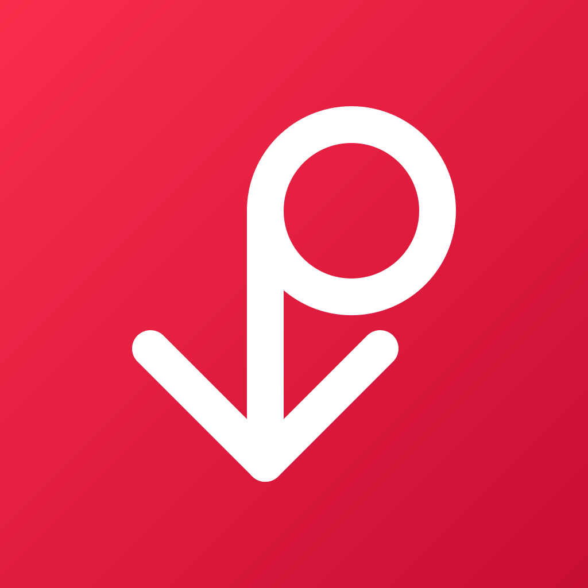
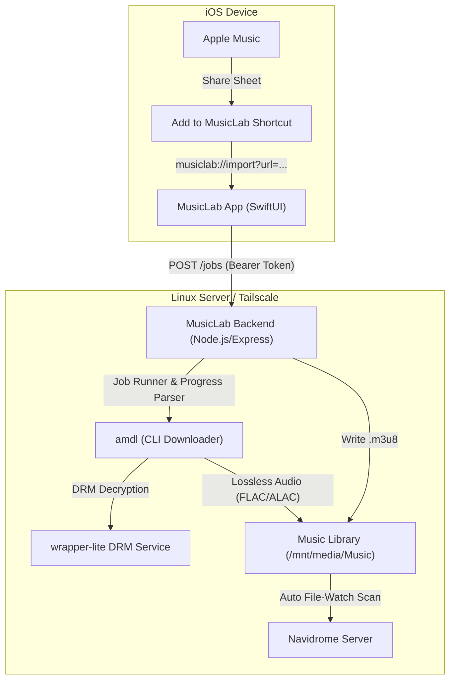

# 🎵 MusicLab

> **A native iOS client and self-hosted backend pipeline to download songs, albums, and playlists from Apple Music straight into your personal Navidrome library with a single tap from the iOS Share Sheet.**

<p align="center">
  
</p>

<p align="center">
  <a href="#features"></a>
  <a href="#building-on-linux-no-mac-needed"></a>
  <a href="#backend-setup"></a>
  <a href="#backend-setup"></a>
</p>

---

## 🎬 The 15-Second Workflow

```
[Apple Music]  ──(Share)──>  [iOS Shortcut]  ──(musiclab://)──>  [MusicLab App]
                                                                        │
                                                                        ▼
[Navidrome Library]  <───  [amdl / FLAC Converter]  <───  [MusicLab Backend]
```

1. **Browse in Apple Music:** Find any track, album, or playlist.
2. **Tap Share → "Add to MusicLab":** Directly from the native iOS Share Sheet.
3. **Watch It Rip:** MusicLab opens to the live Queue with real-time download percentage, throughput speed (MB/s), and ETA.
4. **Instant Stream:** The track lands in your artist/album folders and appears in your Navidrome library immediately.

---

## ✨ Features

- ⚡️ **Native iOS Share Sheet Integration:** Share directly from Apple Music using a lightweight iOS Shortcut deep link (`musiclab://import?url=...`). No manual copy-pasting required.
- 📊 **Real-Time Download Tracking:** Parses downloader stdout live to provide track numbers (`Track x of N`), decryption percent, live throughput, and ETA countdown.
- 🎼 **Smart Ordered Playlists:** Automatically resolves public Apple Music playlists, downloads catalog songs into proper artist/album directories, and writes an order-preserving `.m3u8` playlist for Navidrome.
- 📁 **Multi-Library Destination Steering:** Switch between library targets (e.g. `Bryon's Library`, `Elijah's Library`) directly inside app Settings or per import.
- 🎨 **Sleek SwiftUI Design System:** Dark-mode native interface with custom accent color picker (Apple Music Red, Purple, Cyan, Mint, Orange, Pride), card surfaces, and tactile haptics.
- 🐧 **Built 100% on Linux:** No Mac, Xcode, or Apple Developer hardware needed to develop or build. Compiled using Swift Package Manager and `xtool`.

---

## 🚀 Quick Start

### 1. Set Up the Backend
The backend runs on your server or home-lab host alongside Navidrome:
```bash
git clone https://github.com/ihatenosebleedz/MusicLab.git
cd MusicLab/backend
npm install
npm run generate-token
cp .env.example .env
# Edit .env with your paths, then:
npm start
```
📖 **Detailed guide:** See the [Self-Hosting Setup Guide](docs/SETUP_GUIDE.md) for step-by-step instructions (systemd/OpenRC services, `amdl` CLI, DRM helpers, and Navidrome integration).

### 2. Install the iOS App
1. Download the latest `MusicLab.ipa` from [GitHub Releases](../../releases).
2. Sideload the IPA onto your iPhone using **TrollStore**, **AltStore**, **SideStore**, or **LiveContainer**.
3. Launch MusicLab, enter your backend URL (e.g. `http://100.x.y.z:3000` via Tailscale/LAN) and the secret token.

### 3. Add the Share Sheet Shortcut (30 Seconds)
1. Open the built-in **Shortcuts** app on your iPhone.
2. Tap **(+)** to create a new shortcut named **"Add to MusicLab"**.
3. Tap **(i)** (Details) and toggle ON **"Show in Share Sheet"**.
4. Configure the two actions:
   - **URL:** `musiclab://import?url=` and insert the blue **Shortcut Input** token.
   - **Open URLs:** pass the URL from above.
5. In Apple Music, tap **Share** on any track, scroll to the bottom, tap **Edit Actions**, and tap **(+)** to pin **Add to MusicLab** to your Favorites at the top of the Share Sheet!

---

## 🛠 Architecture



---

## 💻 Building the iOS App on Linux (No Mac Needed!)

MusicLab is engineered to build natively on Linux using `xtool`:

```bash
# Ensure swift and xtool are installed
cd MusicLab

# Run tests
swift build --target MusicLabCoreTests-test-runner -Xlinker --allow-shlib-undefined
.build/debug/MusicLabCoreTests-test-runner

# Build the .app bundle
xtool dev build

# Package unsigned IPA
mkdir -p /tmp/payload/Payload
cp -R xtool/MusicLab.app /tmp/payload/Payload/
(cd /tmp/payload && zip -r MusicLab.ipa Payload)
```

---

## 🔒 Security & Privacy

- **Zero Cloud Intermediaries:** All communication is directly between your personal iPhone and your self-hosted backend over your local LAN or secure Tailscale network.
- **Timing-Safe Auth:** The backend enforces constant-time Bearer token verification.
- **Sanitized Logging:** Per-job stdout/stderr logs are automatically redacted for sensitive tokens before being viewed in the app.

---

## 📄 License

This project is licensed under the [MIT License](LICENSE).
Apple Music is a trademark of Apple Inc. MusicLab is an independent open-source tool for personal home-lab media server integration.
