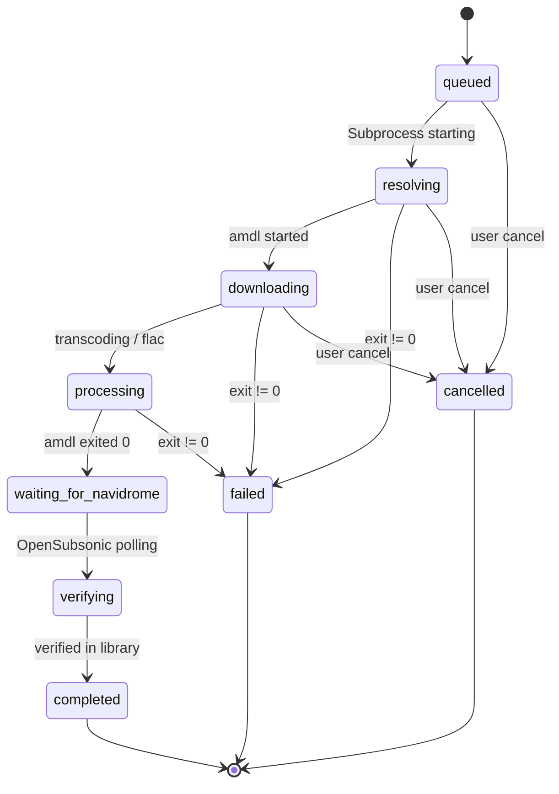

# BACKEND API CONTRACT & AMD_L SPECIFICATION — Music Lab

> Authoritative contract between the iOS app (`MusicLab`), the Node.js backend (`musiclab-backend`), the downloader CLI (`amdl`), and Navidrome.
> Frozen in STEP 5.

---

## 1. Service Architecture & Networking

- **Host:** Gentoo Linux (`192.168.1.100` LAN, `100.x.y.z` Tailscale, hostname `gentoo`).
- **Runtime:** Node.js v26.3.0 (`npm` 11.16.0).
- **Service Deployment:** `/home/nbz/musiclab-backend`, executed as user `nbz`.
- **Binding:** `0.0.0.0:3000` (accessible over Tailscale and local 192.168.4.x LAN).
- **Public Funnel:** Not exposed on Tailscale Funnel. Guarded by Tailscale network encryption and API Bearer Token.

---

## 2. Authentication & Security

- **Scheme:** HTTP Bearer Authentication.
- **Header:** `Authorization: Bearer <token>`
- **Token Format:** 32+ character high-entropy random string generated on the server (`data/token.secret`).
- **Validation:** Constant-time comparison (`crypto.timingSafeEqual`) to prevent timing side-channel attacks.
- **Protected Endpoints:** All `/jobs`, `/catalog`, and `/history` endpoints require the bearer token.
- **Public Endpoints:** `GET /health` is unauthenticated for readiness probes.
- **Execution Isolation:** No arbitrary shell commands are permitted. The backend accepts only validated Apple Music URLs matching `https://music.apple.com/...`. The command argv is constructed strictly as `['./amdl', '--json', validatedUrl]`.

---

## 3. Endpoints

### 3.1 `GET /health`
Returns the status of the backend and underlying services.

- **Auth:** None
- **Response 200 OK:**
```json
{
  "status": "ok",
  "version": "1.0.0",
  "timestamp": "2026-10-13T21:40:00.000Z",
  "services": {
    "amdl": {
      "path": "/home/nbz/apple-music-downloader/amdl",
      "available": true
    },
    "wrapperLite": {
      "endpoint": "http://127.0.0.1:12340",
      "healthy": true,
      "regions": ["us"]
    },
    "navidrome": {
      "endpoint": "http://127.0.0.1:4533",
      "musicFolder": "/mnt/media/Music",
      "openSubsonic": true
    }
  }
}
```

---

### 3.2 `GET /catalog/search`
Proxies Apple Music catalog searches to `amp-api.music.apple.com` using the backend's auto-refreshed anonymous web token. Eliminates any need for API credentials in the mobile app.

- **Auth:** Required
- **Query Parameters:**
  - `term` (string, required): Search query (e.g., `GNX`).
  - `types` (string, optional, default: `albums,songs`): Comma-separated list (`albums`, `songs`, `playlists`, `artists`).
  - `storefront` (string, optional, default: `us`): 2-letter storefront code.
  - `limit` (integer, optional, default: `20`, max: `50`): Result limit.
- **Response 200 OK:**
```json
{
  "results": {
    "albums": [
      {
        "id": "1781290351",
        "type": "album",
        "title": "GNX",
        "artistName": "Kendrick Lamar",
        "releaseDate": "2024-11-22",
        "artworkUrl": "https://is1-ssl.mzstatic.com/.../600x600bb.jpg",
        "trackCount": 12,
        "appleMusicUrl": "https://music.apple.com/us/album/gnx/1781290351",
        "genre": "Hip-Hop/Rap"
      }
    ],
    "songs": []
  }
}
```

---

### 3.3 `POST /jobs`
Submits a new import job.

- **Auth:** Required
- **Request Body:**
```json
{
  "url": "https://music.apple.com/us/album/gnx/1781290351",
  "name": "Kendrick Lamar — GNX",
  "destinationId": "elijah"
}
```
- **Validation:**
  - `url` must parse successfully against `AppleMusicURL` schema (`https://music.apple.com/{storefront}/{type}/...`).
  - `destinationId` (optional) must exist in the server-side `DESTINATIONS` map; otherwise HTTP 400 `INVALID_DESTINATION`. When omitted, the server's `DEFAULT_DESTINATION` is used. When the map is unconfigured, amdl's own config folder is used (legacy).
  - If a job for the identical URL is already active (`queued`, `downloading`, `verifying`), the existing job is returned with HTTP 409 Conflict (or existing job status).
- **Response 201 Created:**
```json
{
  "id": "c1f77d8a-81a2-4a87-b9c2-509f6e14a1e9",
  "type": "album",
  "url": "https://music.apple.com/us/album/gnx/1781290351",
  "name": "Kendrick Lamar — GNX",
  "state": "queued",
  "stage": "resolving",
  "progressHint": "Job enqueued",
  "destinationId": "elijah",
  "destinationPath": "/mnt/media/Music/Elijah's Library",
  "createdAt": "2026-10-13T21:40:00.000Z",
  "updatedAt": "2026-10-13T21:40:00.000Z",
  "addedTracks": []
}
```

---

### 3.4 `GET /jobs`
Lists import jobs.

- **Auth:** Required
- **Query Parameters:**
  - `status` (string, optional): `active`, `completed`, `failed`.
  - `limit` (integer, optional, default: `50`).
- **Response 200 OK:**
```json
{
  "jobs": [
    {
      "id": "c1f77d8a-81a2-4a87-b9c2-509f6e14a1e9",
      "type": "album",
      "url": "https://music.apple.com/us/album/gnx/1781290351",
      "name": "Kendrick Lamar — GNX",
      "state": "verifying",
      "stage": "verifying",
      "progressHint": "Downloading track 30 of 36 • 11 MB/s • ~2s left",
      "progressPercent": 80.6,
      "progressCompleted": 29,
      "progressTotal": 36,
      "etaSeconds": 2,
      "speedText": "11 MB/s",
      "createdAt": "2026-10-13T21:35:00.000Z",
      "updatedAt": "2026-10-13T21:38:00.000Z",
      "addedTracksCount": 12,
      "navidrome": {
        "verified": false,
        "matches": 0
      }
    }
  ]
}
```

> **Live progress fields.** While a job downloads, the runner streams amdl's
> stdout and fills `progressPercent` (0–100), `progressCompleted` /
> `progressTotal` (songs for playlists, tracks for a single album),
> `etaSeconds` (estimated from the observed download rate) and `speedText`
> (e.g. `"11 MB/s"`). They are `null`/`0` before the first download signal and
> `progressPercent` is `100` once processing finishes.

---

### 3.5 `GET /jobs/:id`
Returns full job inspection details.

- **Auth:** Required
- **Response 200 OK:**
```json
{
  "id": "c1f77d8a-81a2-4a87-b9c2-509f6e14a1e9",
  "type": "album",
  "url": "https://music.apple.com/us/album/gnx/1781290351",
  "name": "Kendrick Lamar — GNX",
  "state": "completed",
  "stage": "done",
  "progressHint": "12 tracks downloaded and verified in Navidrome",
  "createdAt": "2026-10-13T21:35:00.000Z",
  "updatedAt": "2026-10-13T21:39:00.000Z",
  "startedAt": "2026-10-13T21:35:02.000Z",
  "finishedAt": "2026-10-13T21:39:00.000Z",
  "exitCode": 0,
  "stdoutTail": "Completed: 12/12\nSuccess",
  "stderrTail": "",
  "addedTracks": [
    {
      "title": "wacced out murals",
      "artist": "Kendrick Lamar",
      "album": "GNX",
      "path": "/mnt/media/Music/Kendrick Lamar/GNX (2024)/01 - wacced out murals.flac"
    }
  ],
  "navidrome": {
    "verified": true,
    "checkedAt": "2026-10-13T21:39:00.000Z",
    "matches": 12
  }
}
```

---

### 3.6 `POST /jobs/:id/cancel`
Cancels an active job.

- **Auth:** Required
- **Behavior:** Sends `SIGTERM` to the process group (`-pgid`), followed by `SIGKILL` after 5 seconds if still active. Updates job state to `cancelled`.
- **Response 200 OK:**
```json
{
  "id": "c1f77d8a-81a2-4a87-b9c2-509f6e14a1e9",
  "state": "cancelled",
  "cancelledAt": "2026-10-13T21:40:00.000Z"
}
```

---

### 3.7 `GET /destinations`
Lists the server-side import destinations. **Auth:** required.

```json
{
  "destinations": [
    { "id": "bryon", "isDefault": true },
    { "id": "elijah", "isDefault": false }
  ],
  "defaultId": "bryon"
}
```
- Paths are never returned; clients only see opaque ids. Configured via the
  server `.env` (`DESTINATIONS` JSON map, `DEFAULT_DESTINATION`).

---

### 3.8 `GET /logs`
Authenticated, paginated, redacted log aggregation.

- **Auth:** Required
- **Query Parameters:**
  - `source` (optional): `all` (default) | `backend` | `job` | `wrapper`.
  - `jobId` (optional): scopes the result to a single job's amdl output (overrides `source`).
  - `limit` (optional, default `100`, max `500`); `offset` (optional, default `0`).
- **Errors:** 400 `INVALID_SOURCE`; 404 `JOB_NOT_FOUND` (unknown `jobId`).
- **Response 200 OK:**
```json
{
  "logs": [
    { "source": "job", "jobId": "c1f77d8a-...", "stream": "stdout", "at": "2026-10-16T05:00:00.000Z", "line": "Downloading track: ..." },
    { "source": "backend", "stream": "service", "at": "2026-10-16T05:00:00.000Z", "line": "server started" }
  ],
  "page": { "limit": 100, "offset": 0, "total": 2, "hasMore": false },
  "available": { "backend": true, "job": true, "wrapper": false }
}
```
- **Redaction:** every line passes through `redact()` — Bearer tokens,
  `name=value` / `name: value` credential shapes, and the exact live secrets
  (Navidrome password/token, backend bearer) are masked as `[REDACTED]`.
- `backend` / `wrapper` sources require `LOG_FILE` / `WRAPPER_LOG_FILE` to be set.

---

### 3.9 Error Response Format
All errors return a consistent RFC-7807 inspired envelope:
```json
{
  "error": {
    "code": "INVALID_URL",
    "message": "The provided URL is not a valid Apple Music catalog link.",
    "details": "Expected host music.apple.com"
  }
}
```
Standard error codes:
- `UNAUTHORIZED` (401): Missing or invalid Bearer token.
- `INVALID_URL` (400): Malformed or unsupported URL.
- `JOB_NOT_FOUND` (404): Job ID does not exist.
- `JOB_ALREADY_ACTIVE` (409): Identical item currently in download queue.
- `DOWNLOADER_ERROR` (500): `amdl` CLI failed with non-zero exit code.
- `WRAPPER_LITE_OFFLINE` (503): wrapper-lite DRM service is unreachable.

---

## 4. `amdl` Subprocess Execution Contract

### 4.1 Working Directory and Invocation
- **Binary:** `./amdl` (resolved against the amdl repo dir, default
  `/home/nbz/apple-music-downloader`).
- **Execution Arguments:**
  ```bash
  ./amdl --json "<apple-music-url>"
  ```
  *(Note: There is no `--url` flag; `<url>` is passed as a positional argument.
  `--json` emits the JSON summary on completion. There is also no destination /
  output flag.)*
- **CWD / save folder:** `amdl` reads `config.yaml` from its **current working
  directory** (`internal/app/config.go: os.ReadFile("config.yaml")`) and has no
  destination flag. So the only way to steer the save folder per import is the
  CWD:
  - No destination ⇒ run from the amdl repo dir (legacy behaviour).
  - With a destination (Step 8) ⇒ the backend generates a per-destination dir
    (`data/destinations/<hash>/`) containing a copy of the real config with
    **only** `alac/atmos/aac-save-folder` rewritten to the destination path
    (credentials and all other settings preserved), plus a copy of
    `config.yaml.example`, and spawns `amdl` from there. A destination that
    cannot be materialised fails the job rather than writing to the wrong folder.

### 4.2 Process Group & Cancellation
- The process is spawned with `{ detached: true }` so it heads its own process group (`pgid = child.pid`).
- To cancel:
  ```javascript
  process.kill(-child.pid, 'SIGTERM');
  ```
  This cleanly terminates `amdl` and any child `ffmpeg` transcode subprocesses.

### 4.3 Output Format Parsing
- **Exit Code 0 (Success):**
  The last non-empty line of `stdout` contains a JSON array of `AddedTrack` objects:
  ```json
  [
    {
      "path": "/mnt/media/Music/Artist/Album/01 Track.flac",
      "artist": "Kendrick Lamar",
      "artist_id": "368183298",
      "album": "GNX",
      "song": "wacced out murals"
    }
  ]
  ```
  *Note: `amdl` emits `"song"`, which maps to track title (`title = track.song || track.title`).*
- **Exit Code != 0 (Failure):**
  `config.yaml` has `exit-on-error: true`. Any failure (e.g. rate limit, unavailable track) exits immediately with code `1`. The backend captures the last 50 lines of `stderr` and `stdout` into `job.stderrTail` and sets `state = failed`.

---

## 5. Navidrome Verification Contract

### 5.1 Verification Principles
- **No Trigger Scans:** Per user requirement, Navidrome auto-discovers library changes in `/mnt/media/Music`. The backend must **never** call scan trigger endpoints.
- **Verification Strategy:**
  1. **Filesystem Check:** Verify `fs.existsSync(track.path)` for every track returned in `AddedTrack[]`.
  2. **OpenSubsonic Polling:** Query Navidrome's OpenSubsonic API:
     ```
     GET /rest/search3.view?query={title}&u={username}&t={token}&s={salt}&v=1.16.1&c=musiclab&f=json
     ```
  3. **Backoff Schedule:** Check at `t = 2s, 4s, 8s, 16s, 32s, 64s, 120s`.
  4. **Timeout:** If tracks are verified on the filesystem but do not appear in OpenSubsonic within 120 seconds, mark `navidrome.verified = false` but `state = completed` with a note `"File present on disk; awaiting Navidrome index cycle"`.

---

## 6. Job State Machine & Persistence



### 6.1 Database Schema (SQLite: `data/jobs.db`)
```sql
CREATE TABLE IF NOT EXISTS jobs (
    id TEXT PRIMARY KEY,
    type TEXT NOT NULL,
    url TEXT NOT NULL,
    name TEXT NOT NULL,
    state TEXT NOT NULL,
    stage TEXT,
    progress_hint TEXT,
    exit_code INTEGER,
    stdout_tail TEXT,
    stderr_tail TEXT,
    created_at TEXT NOT NULL,
    updated_at TEXT NOT NULL,
    started_at TEXT,
    finished_at TEXT,
    navidrome_verified INTEGER DEFAULT 0,
    navidrome_checked_at TEXT,
    navidrome_matches INTEGER DEFAULT 0
);

CREATE TABLE IF NOT EXISTS job_tracks (
    id INTEGER PRIMARY KEY AUTOINCREMENT,
    job_id TEXT NOT NULL,
    title TEXT NOT NULL,
    artist TEXT NOT NULL,
    album TEXT NOT NULL,
    path TEXT NOT NULL,
    FOREIGN KEY(job_id) REFERENCES jobs(id) ON DELETE CASCADE
);
```

### 6.2 Restart Recovery
On backend startup:
1. Query `SELECT * FROM jobs WHERE state IN ('queued', 'resolving', 'downloading', 'processing', 'waiting_for_navidrome', 'verifying')`.
2. For jobs in `downloading`/`processing`: check if process still exists via `process.kill(pid, 0)`. If process is gone:
   - Check if files exist at target location.
   - If files exist, transition to `waiting_for_navidrome`.
   - If not, transition to `failed` with error code `SERVER_RESTARTED`.
